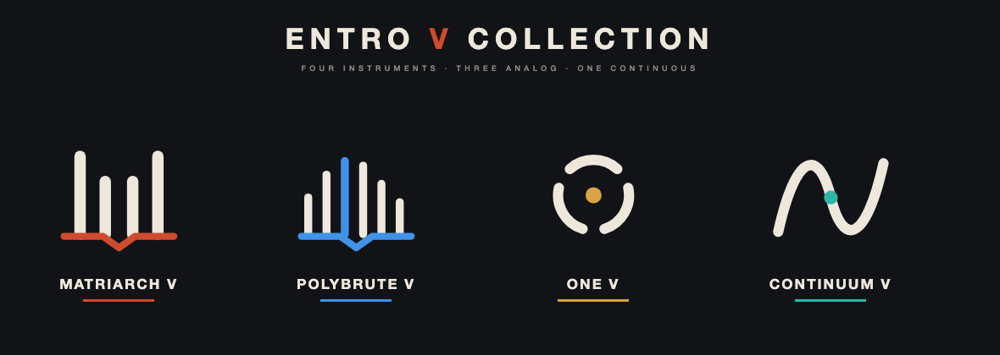

# ENTRO V COLLECTION

**Inspired by Arturia V Collection.**


四款独立发声的乐器插件，共用一个 C++20 / JUCE 9.0.4 代码库。前三款是虚拟模拟合成器，第四款是连续曲面 / EIGEN MATRIX 乐器：

| 插件 | 对应实体合成器的功能组织 | 格式 |
|---|---|---|
| **MATRIARCH V** | 四振荡器准复音、立体声梯形滤波、双包络、双 LFO、90 类插接点、BBD 立体声延迟 | VST3 / AU / Standalone |
| **POLYBRUTE V** | 六声部、双 VCO + Sub、Metalizer、Steiner + Ladder 双滤波、三包络、三 LFO、调制矩阵、效果链 | VST3 / AU / Standalone |
| **ONE V** | 三个 Synth 部分共享声部池、每声部三 VCO、SVF + Ladder、三个 DAHDSR 包络、四个 LFO、效果 | VST3 / AU / Standalone |
| **CONTINUUM V** | 红黑条纹连续 X/Y/Z 演奏面、8 声部 MPE、EIGEN MATRIX 16×16 路由、5 OSC、5 滤波、2 组 biquad bank、5 SG、双延迟、FDN reverb | VST3 / AU / Standalone |

CONTINUUM V 的演奏面按原机红黑条纹重绘；EIGEN MATRIX 是原创矩阵引擎，预设沿用 Continuum 的两字母系统类别（`ST`、`WI`、`VO`、`KY`、`CL`、`OT`、`PE`、`PT`、`PR`、`DO`、`MD`、`UT`），不包含 Haken 原厂预设数据。

本项目是**独立实现的软件乐器**，不是 Arturia 或 Moog 的官方产品，也不包含原厂固件、原始预设文件或界面素材。"Inspired by Arturia V Collection" 只说明产品企划与音色组织上的参照，不表示任何隶属、授权或背书。面板按公开手册与产品照片重绘，音频引擎全部自行实现。手册只描述操作与信号路径，不提供电路容差、非线性元件或专有数字效果的算法；因此本项目不声称“逐电路”或“与实机完全相同”。详见 [COVERAGE.md](docs/COVERAGE.md)。

## 当前状态

四款插件均已能编译为 macOS arm64 的 VST3 / AU / Standalone，并带有独立引擎、实体布局面板、预设与工程状态保存。真实进度以 [docs/COVERAGE.md](docs/COVERAGE.md) 与 [docs/VALIDATION.md](docs/VALIDATION.md) 为准；未写入“已测试”的功能不视为完成。

- 已完成并通过自动测试：三套引擎的确定性音频、音高、参数极值、延音/叠音/弯音/触后/All Notes Off、厂牌预设校验。
- 已完成并通过验证器：三个 VST3 在 pluginval strictness 5 通过；三个 AU 通过 `auval`。
- 已完成：Matriarch 虚拟接线（79 个插孔）、PolyBrute Morph A/B 与 8 槽调制矩阵、Moog One 三部分共享声部池与每部分 8 槽矩阵。
- 已完成：GitHub Actions 的 macOS / Windows 构建；预设浏览器与按类别分组的 factory bank；四款原创 logo 与 app 图标。
- 已完成：CONTINUUM V 的连续曲面与 EIGEN MATRIX 核心（M1）；EaganMatrix 的完整专有 DSP、48 段 biquad 与用户公式 VM 仍属于 M2。
- 未完成：实机音色校准、DAW 实测、Developer ID 签名/公证、M2 的 EaganMatrix 深度还原，以及覆盖表中列出的硬件细节（硬件实时录制与 Motion、One 每部分独立琶音等）。

Matriarch 的键盘按原机 49 键 F1–F5 显示；音高以 A4 = 440 Hz 为基准，并有自动回归测试。

## 构建

依赖：

- macOS 11+ 或 Windows 10+ x64
- CMake 3.22+
- Xcode / Clang（macOS）或 Visual Studio 2022（Windows）
- JUCE **9.0.4**，放在源码树之外
- Ninja（推荐）

```bash
# 1. 获取固定版本的 JUCE
git clone --branch 9.0.4 --depth 1 https://github.com/juce-framework/JUCE.git ../work/JUCE

# 2. 配置（构建目录放在仓库外）
cmake -S . -B ../work/build-triad -G Ninja \
      -DCMAKE_BUILD_TYPE=Release \
      -DTRIAD_JUCE_PATH=../work/JUCE

# 3. 编译
cmake --build ../work/build-triad

# 4. 运行确定性引擎测试
ctest --test-dir ../work/build-triad --output-on-failure
```

产物位置：

```
../work/build-triad/Matriarch_artefacts/Release/VST3/MATRIARCH V.vst3
../work/build-triad/Matriarch_artefacts/Release/AU/MATRIARCH V.component
../work/build-triad/Matriarch_artefacts/Release/Standalone/MATRIARCH V.app
../work/build-triad/Continuum_artefacts/Release/VST3/CONTINUUM V.vst3
../work/build-triad/Continuum_artefacts/Release/AU/CONTINUUM V.component
../work/build-triad/Continuum_artefacts/Release/Standalone/CONTINUUM V.app
```

POLYBRUTE V 的产物名是 `POLYBRUTE V.vst3` / `POLYBRUTE V.component`；ONE V 的产物名带空格：`ONE V.vst3`、`ONE V.component`。构建目标名是 `Matriarch_VST3`、`MoogOne_AU` 等。

Universal 构建：

```bash
cmake -S . -B ../work/build-triad-universal -G Ninja \
      -DCMAKE_BUILD_TYPE=Release -DTRIAD_UNIVERSAL=ON -DTRIAD_JUCE_PATH=../work/JUCE
```

## 安装（自用）

```bash
# 安装当前用户可见的 VST3 与 AU，并复制独立程序到 /Applications
./scripts/package-macos.sh --build ../work/build-triad --install
```

脚本只复制已经编译成功的产物，不会伪造未生成的格式。卸载时删除：

```
~/Library/Audio/Plug-Ins/VST3/MATRIARCH V.vst3
~/Library/Audio/Plug-Ins/VST3/POLYBRUTE V.vst3
~/Library/Audio/Plug-Ins/VST3/ONE V.vst3
~/Library/Audio/Plug-Ins/Components/MATRIARCH V.component
~/Library/Audio/Plug-Ins/Components/POLYBRUTE V.component
~/Library/Audio/Plug-Ins/Components/ONE V.component
```

首次加载未签名插件时，macOS 可能要求在“系统设置 → 隐私与安全性”中允许。正式分发需要 Developer ID 签名与公证，本项目当前没有该身份。

Windows 使用 GitHub Actions 的 Windows runner 构建，产物为 `.vst3` 与 `.exe`；未在本机验证的 Windows DAW 加载结果不会写成“已测试”。

## 使用

- 顶部栏有四个插件共用的 **OUT 全局输出音量**（-60..+12 dB，独立于预设保存）；选择预设、INIT、保存/载入 `.triadpreset` 文件；`BROWSE` 打开预设浏览器（分类筛选、搜索、列表/详情）；预设按 Bass / Lead / Brass / Pad / Strings / Winds / Vocal / Keyboard / Classic / Other / Percussion / Tuned Percussion / Processor / Drone / Midi / Pluck / Keys / Organ / Arp / Sequence / Split / Utility / FX 分类，名称带 `BA -`、`LD -` 等类型前缀；顶部 `BROWSE` 打开可搜索浏览器。四台琴分别内置 167、171、242、761 个预设（含 Reese、Acid、Supersaw、Warm Pad、Organ、Pluck 以及 Continuum 的 Strings/Winds/Vocal/Keyboard/Classic/Other 等原厂类别预设（含 Harp、Koto、Glass Harp，以及按真实乐器重做的 Piano/Violin/Flute/Guitar/Bell 等音色））。
- 面板按官方手册与产品照片重排：Matriarch 单行模块顺序、PolyBrute 三段式合成区（VCO/滤波/包络/LFO 三行）、Moog One 左/中/右三块面板。资料页码与模块位置见 [docs/LAYOUT.md](docs/LAYOUT.md)。旋转拖动旋钮，双击回到默认值；硬件开关按档位点击。
- 底部键盘可点击演奏；滚轮为 Pitch/Mod（Pitch 松手回中）。Matriarch 显示 49 键 F1–F5，PolyBrute 与 Moog One 显示 61 键 C2–C7。Moog One 的 `MIDI PART` 选择屏幕键盘发送到哪一部分。
- Matriarch 插线：先点一个输出插孔，再点一个输入插孔建立连线；右键点击插孔清除与它相连的线缆。线缆随工程状态保存。
- PolyBrute：`CAPTURE B` 把当前面板存入 B，`MORPH` 在 A/B 之间插值；`SWAP A/B` 交换两侧。
- 所有参数均暴露给宿主自动化、MIDI Learn 与工程保存。宿主自动化按块应用，不宣称样本精确。

## 目录

```
src/core       与框架无关的参数、引擎契约、DSP 基元、琶音/音序器
src/engines    Matriarch / PolyBrute / One 的独立实现（无 JUCE 类型）
src/plugin     JUCE 处理器、参数树、状态、预设、宿主总线
src/ui         矢量绘制的实体面板、控件、键盘、虚拟插线（不嵌入厂商图片）
tests          确定性的离线音频与引擎契约测试
scripts        打包与安装
assets         四款 logo 的 SVG/PNG、macOS .icns 与 Windows .ico
docs           覆盖表、验证记录、开发约定
```

## 许可与免责

本仓库为自用项目，尚未选择开源许可证；在添加许可证前不要公开分发源码或二进制。JUCE 的许可随所选版本与分发方式决定（参见 JUCE 9 许可条款）。Arturia、Moog、PolyBrute、Matriarch、Moog One、Eventide 等名称属于各自权利人，仅用于说明参照对象。本项目 **Inspired by Arturia V Collection**，但与 Arturia、Moog 均无隶属、授权或背书关系。

仓库：<https://github.com/SakuraEntropia/ENTRO-V-COLLECTION>

Haken 10.09 soundlist 对照：[docs/Haken-Soundlist-10-09.md](docs/Haken-Soundlist-10-09.md)。

Logo 源文件：`assets/logos/*.svg`；应用图标：`assets/icons/*.icns` / `*.ico`。重新生成使用 `python3 scripts/generate-logo-assets.py`。

本轮新增 22 个原版参考改编预设，来源、转换方法与限制见 [预设参考记录](docs/PRESET-REFERENCES.md)。三款模拟琴顶部 `SEQ` 打开步进编辑器；PolyBrute 调制连接支持 64 槽分页，One 支持共享 8/16 声部与每部分 Mono/Unison，Matriarch/One 可启用宿主音频输入。

四款各增加 **64 个 Studio 预设，共 256 个**。在 BROWSE 搜索 `Studio`；类别、结构与试听导出见 [Studio 音色库](docs/STUDIO-PRESETS.md)。

旧音色修复与新增 **128 个 Stage 音色**见 [修复记录](docs/LEGACY-STAGE-PRESETS.md)。在 BROWSE 搜索 `Stage`。已启用每批验证完成后备份并替换本机已安装版本的流程。

本轮参考官方工厂库新增 **256 个音色**：每款32个 `Atelier` 乐器拟真研究音色；One另有64个 `Saw Atlas` 宽广锯齿共振Pad；另补64个 `Signature` 音色。来源完整目录与设计见 [SIGNATURE-SOUNDS.md](docs/SIGNATURE-SOUNDS.md)。


2026-10-25 修订：175 个 Pad 降低共振、移除明显滤波扫动；四款各新增 4 个 `[Sampled]` 真实采样乐器（Kawai 立式钢琴、小提琴声部、大提琴声部、独奏小提琴），采样随插件安装。旧 Atelier 钢琴和弦乐在重新选择工厂预设时也使用相应采样源。其他拟真合成研究音色仍是近似。采样模式会标明合成滤波器旁路，详见 [实现与限制](docs/CLEAN-PAD-SAMPLED.md) 与 [采样来源](assets/samples/SOURCES.md)。
